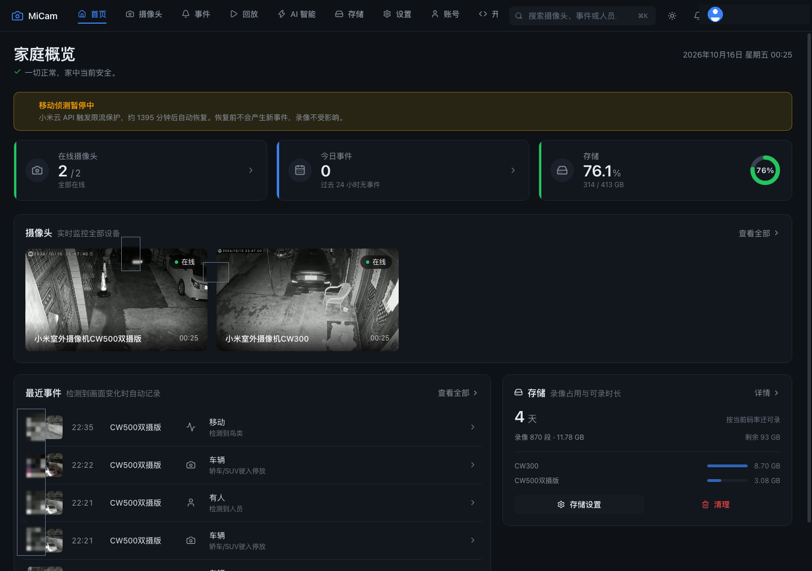
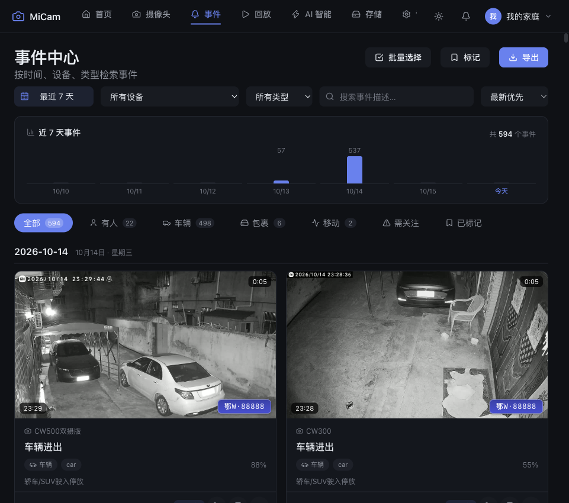
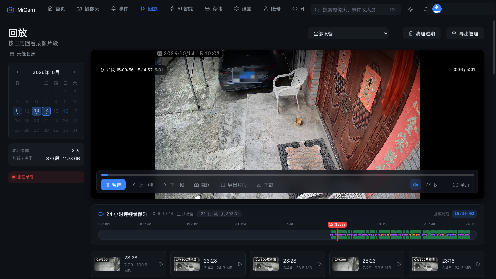
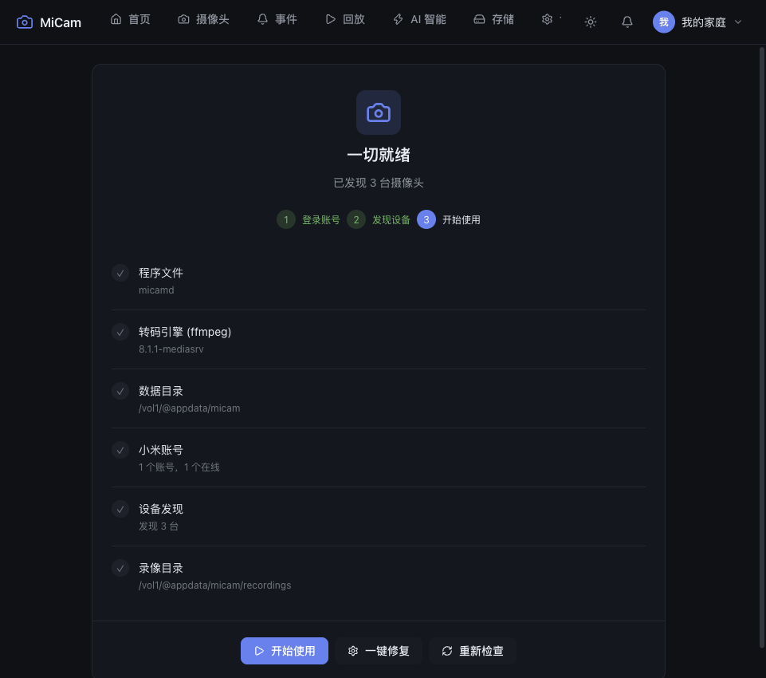
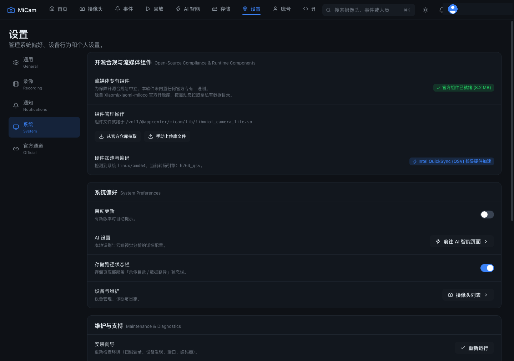
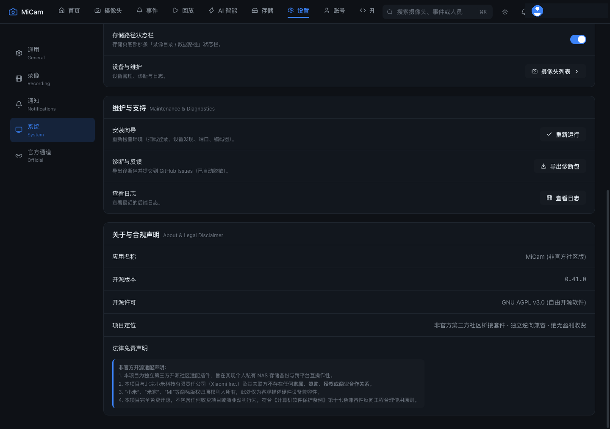

# 【原创首发】MiCam v0.41.0 飞牛专属插件：小米摄像头免刷机接入 / 2K极清低延迟 / 0秒拖拽回放 / 本地24H录像 / AI 自然语言智能问答

> **插件名称**：MiCam (小米摄像头社区接入套件)  
> **适用机型**：支持全部 x86_64 / amd64 架构的飞牛 NAS（支持 Intel QSV 核显硬件加速，亦全面支持 J4125/N100 等低功耗 CPU 超快软解）  
> **项目开源地址**：[https://github.com/AmigaMeow/micam](https://github.com/AmigaMeow/micam)  
> **插件包直接下载 (GitHub Release)**：  
> [micam_0.41.0_amd64.fpk 下载链接](https://github.com/AmigaMeow/micam/releases/download/v0.41.0/micam_0.41.0_amd64.fpk)

---

### 一、为什么做这个插件？

家里有小米/米家摄像头（如 CW500 双摄版、CW300 等主流室外机/云台机），想接入 NAS 集中存储与监控，通常面临三大痛点：
1. **不想拆机或刷机**：官方固件没有直接开放 RTSP，网上破解教程门槛高且丢保修；
2. **回放卡顿、寻道死锁**：使用普通播放器或群晖/Docker 方案回放 H.265 大码率监控视频时，频繁出现黑屏、长时间转圈或断流；
3. **查监控像在大海捞针**：发生事件时，传统监控只能凭记忆拉着时间轴一秒秒找，效率极低。

**MiCam** 专为飞牛 fnOS 深度定制，无需拆机、无需破解固件，只要扫码登录米家账号即可自动发现局域网内的摄像头，不仅实现免刷机高清直连、24 小时本地存储与丝滑拖拽回放，更带来了**颠覆传统安防的 AI 自然语言智能对话与事件秒搜**！

---

### 二、核心功能亮点

#### 1. 🤖 AI 智能问答对话：自然语言即时追查监控（杀手级特性！）
- **像与管家交谈一样搜监控**：
  直接提问 *“小狗今天经过车位几次？”*、*“找最近出现的黑色 SUV”*、*“昨晚后院有人吗？”*、*“今天有人送快递包裹吗？”*；
- **YOLOv8 秒级结构化检索**：
  本地 AI 引擎自动在后台对监控录像建立人/车/包裹/宠物索引，提问后 0.1 秒精准定位全部关键时间点与抓拍证据卡片；
- **证据卡片就地播放**：
  搜索出的线索卡片直接呈现事件缩略图、发生时间、机位区域，点击即可在对话气泡中**原地微缩视频播放**或一键跳入完整历史回放；
- **云端视觉大模型逐帧深度复查（可选）**：
  支持接入深度视觉模型（如 DeepSeek 视觉模型），对关键疑难画面进行逐帧比对推导，输出详尽证据链报告。

#### 2. ⚡ 零改造免刷机直连：
- 官方扫码授权，自动绑定局域网摄像机；
- 支持 2K / 1080P 高清实时流，支持双摄机位（主摄固定 + 副摄云台）画中画与独立预览；
- 支持云台 PTZ 控制（上下左右四向微调、方向反转自适应）。

#### 3. 🎬 24 小时本地循环录像与秒级拖拽寻道（彻底解决黑屏）：
- 本地磁盘原画流无损直存（`-c copy`），零 CPU 占用；
- 重构录像转码切片与原生 HTTP Range 字节流服务，24 小时时间轴任意点击即刻出帧，告别黑屏死锁；
- 低功耗 CPU（如 J4125、N100 等）转码深度优化，无核显也能 60fps+ 极速切片出流。

#### 4. 📊 智能事件中心与近 7 天动态趋势：
- **AI 智能多重标记**：自动分类「有人」、「车辆进出」、「快递包裹」、「画面移动」等事件，支持精准车牌号码智能抓取与高亮标注；
- **7 天事件密度趋势柱状图**：按天直观呈现事件多寡与活跃度，每日安全状况一目了然；
- **智能范围自适应**：进入事件中心时，若当天暂无新动静，自动智能切换并呈现「近 7 天事件」，同时配备友好的状态提示与一键直达入口。

#### 5. 🛠 首次安装向导与一键自检自愈：
- 针对飞牛 NAS 新用户，开箱即提供清晰的 3 步初始化引导（1 登录账号 → 2 发现设备 → 3 开始使用）；
- 集成底层环境健康体检表（程序文件、转码引擎、数据目录、录像目录），支持「一键智能修复」，零折腾即可顺畅启动。

#### 6. ⚖️ 开源合规与物理隔离架构：
- 遵循 AGPL-3.0 协议，严守开源与版权合规；
- 严格物理隔离专有二进制库，采用 BYOB 安全动态获取架构，支持一键从官方开源库拉取组件。

#### 7. 🔔 多端联动与报警推送：
- 支持多渠道通知推送（Home Assistant、Bark、企业微信、钉钉、飞书、Pushover、n8n 等）。

---

### 三、系统界面实测截图展示

*(发帖时可上传下列高清无隐私截图，所有车牌及家庭信息均已脱敏)*

1. **AI 智能问答对话（自然语言搜索事件证据链，支持原地微缩播放）**  
   

2. **监控大屏实时全览（双摄/多路预览）**  
   

3. **智能事件中心（AI 车牌/人形检测打标 + 7 天事件趋势柱状图）**  
   

4. **24 小时时间轴拖拽极速回放（任意定位无缝出帧）**  
   

5. **首次安装向导（3 步引导 + 环境自检与一键修复）**  
   

6. **系统设置与流媒体组件状态（支持 QSV 硬件加速与组件自检）**  
   

7. **关于与合规免责声明（AGPL-3.0 许可证保障）**  
   

---

### 四、快速安装与上手指南

1. **下载插件包**：
   从 GitHub Release 下载 [micam_0.41.0_amd64.fpk](https://github.com/AmigaMeow/micam/releases/download/v0.41.0/micam_0.41.0_amd64.fpk) 到本地电脑。
2. **手动安装到飞牛 NAS**：
   - 登录飞牛桌面，打开【应用中心】；
   - 点击右上角【手动安装】，选择刚才下载的 `.fpk` 文件并确认安装。
3. **初次运行向导**：
   - 安装完成后，在桌面打开 **MiCam**，系统会自动启动【首次安装向导】；
   - 检查环境项（程序文件、ffmpeg 转码引擎、存储目录），如有异常点击【一键修复】即可自动完成就绪。
4. **扫码登录米家账号**：
   - 进入【账号管理】页面，点击【添加账号】；
   - 使用米家 App 扫描屏幕二维码完成授权，即可自动识别并添加局域网内的摄像头！
5. **体验 AI 智能问答与事件回放**：
   - 录像记录一段时间后，点击顶部菜单【AI 智能】→【智能问答】；
   - 点击推荐气泡或直接输入提问，立刻感受自然语言抓查录像的智能体验！

---

### 五、常见问题与反馈

- **关于其他型号适配**：只要是米家局域网通信协议的摄像机均可尝试接入。如果遇到未适配型号，欢迎在 GitHub Issues 提交设备型号与日志，我们会第一时间跟进兼容！
- **开源交流与反馈**：
  GitHub 仓库：[https://github.com/AmigaMeow/micam](https://github.com/AmigaMeow/micam)
  欢迎大家安装体验、提 Issue 和 PR，也恳请走过路过的朋友随手点一个 ⭐️ Star 支持！
